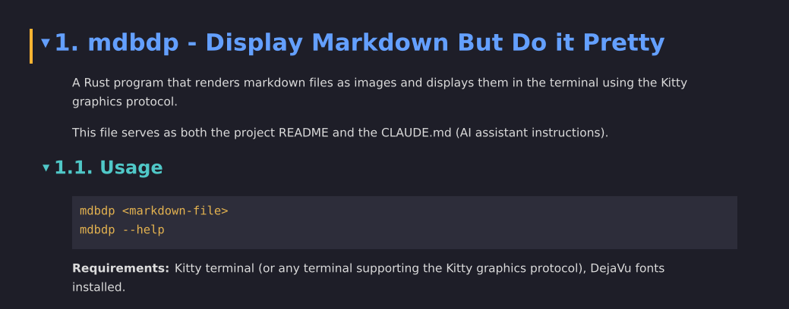

# dmbdip - Display Markdown But Do it Pretty



A Rust program that renders markdown files as images and displays them in the terminal using the Kitty graphics protocol, including mermaid diagrams. Includes basic file navigation utilities.

## Usage

```
dmbdip [markdown-file-or-directory]
dmbdip --serve
dmbdip --help
```

When given a markdown file, opens it full-width with the file list hidden. Press Left to reveal the file list and browse sibling files. When given a directory (or no argument), opens the file browser with a file list on the left and markdown preview on the right.

`dmbdip --serve` runs a headless render server (line-delimited JSON on stdin/stdout) used by the [Neovim preview](#neovim-preview).

**Requirements:**  a terminal supporting the [Terminal graphics protocol](https://sw.kovidgoyal.net/kitty/graphics-protocol/), DejaVu fonts installed.

## Installation

### From crates.io

```
cargo install dmbdip
```

### Pre-built binaries

Download pre-built binaries for Linux (x86_64) and macOS (x86_64, Apple Silicon) from the [GitHub Releases](https://github.com/sapristi/dmbdip/releases) page.

On macOS, you'll need DejaVu fonts installed:

```
brew install font-dejavu
```

### Building from source

Requires Rust (1.85+ for edition 2024). Install via [rustup](https://rustup.rs/).

```
cargo build --release
```

Install directly with cargo:

```
cargo install --path . --root ~/.local
```

## Keybindings

### Document View

| Key | Action |
|-----|--------|
| Tab/Shift+Tab | Navigate between headings |
| Space | Toggle fold open/close |
| Right | Hide file list (full-width reading) |
| Left | Show file list / back to browser |
| Up/Down | Scroll |
| j/k | Small scroll steps |
| PgUp/PgDn | Half-page scroll |
| Home/End | Jump to top/bottom |
| / | Search text (vim-style) |
| n/N | Next/previous search match |
| h | Show keybindings help overlay |
| q/Esc/Ctrl-C | Quit |

### File Browser

| Key | Action |
|-----|--------|
| Up/Down, j/k | Move cursor |
| Right/Enter | Open file / enter subfolder |
| Left | Go to parent directory |
| e | Open in $EDITOR |
| Ctrl-H | Toggle hidden files |
| h | Show help |
| q/Esc/Ctrl-C | Quit |

## Neovim preview

Two commands, both for the current markdown buffer:

- `:DmbdipToggle` swaps the current window between the markdown source and its rendered preview, keeping the reading position both ways. This is the main way to read a document: toggle, scroll, toggle back.
- `:DmbdipPreview` opens the preview in a vertical split that follows unsaved edits and scrolls with the source window. Run it again (or close the split) to close it.

In the preview, sections fold like in the TUI, without re-rendering: folds are plain neovim folds (`zc`, `zo`, `za`, `zR`, `zM` work), and a ▼/▶ arrow beside each heading plus a bar beside the current heading show the state. Three functions act on the preview in the current window (no-op elsewhere):

- `require("dmbdip").next_heading()` / `.prev_heading()` (`:DmbdipNextHeading`, `:DmbdipPrevHeading`): move to the next / previous visible heading, placed a quarter down the window;
- `require("dmbdip").toggle_fold()` (`:DmbdipFold`): fold or unfold the section the cursor is in.

The plugin defines no key mapping; the preview buffer has `filetype=dmbdip`, so keys can be mapped for it only (see the `keys` entries below).

**Requirements:**

- a terminal supporting kitty unicode image placeholders (kitty, ghostty; tmux with passthrough works)
- `termguicolors` enabled
- `ambiwidth=single` (the default): `ambiwidth=double` is not supported, it makes each placeholder cell 2 columns wide
- [snacks.nvim](https://github.com/folke/snacks.nvim)
- `dmbdip` on `$PATH`, from the same version as the plugin (the plugin refuses an older or newer binary)
- neovim ≥ 0.10
- neovim and the terminal on the same machine (not over SSH yet)

Install with [lazy.nvim](https://github.com/folke/lazy.nvim):

```lua
{
  "sapristi/dmbdip",
  dependencies = { "folke/snacks.nvim" },
  cmd = { "DmbdipPreview", "DmbdipToggle" },
  keys = {
    { "<leader>mp", "<cmd>DmbdipToggle<cr>", desc = "Toggle markdown preview" },
    -- in the preview buffer only
    { "<Tab>", function() require("dmbdip").next_heading() end, ft = "dmbdip", desc = "Next heading" },
    { "<S-Tab>", function() require("dmbdip").prev_heading() end, ft = "dmbdip", desc = "Previous heading" },
    { "<Space>", function() require("dmbdip").toggle_fold() end, ft = "dmbdip", desc = "Toggle fold" },
  },
  opts = {}, -- optional: { cmd = "dmbdip", debounce_ms = 150 }
}
```

Large documents are fine: the preview is rendered strip by strip on demand and only the strips near the view are kept in the terminal, so memory does not grow with the document's length.

**Known limits:** scrolling is by cell rows; folds of the markdown source are not mirrored in the preview; a fold closed inside a closed section reopens when the document is re-laid out (e.g. after an edit).

## Configuration

Customize theme colors, font sizes, layout, and fonts via a TOML config file at `~/.config/dmbdip/dmbdip.toml`. All fields are optional. See [docs/configuration.md](docs/configuration.md) for the full reference.

## Development

See [docs/DEVELOPMENT.md](docs/DEVELOPMENT.md) for architecture, tech stack, task tracking, and workflow notes.
